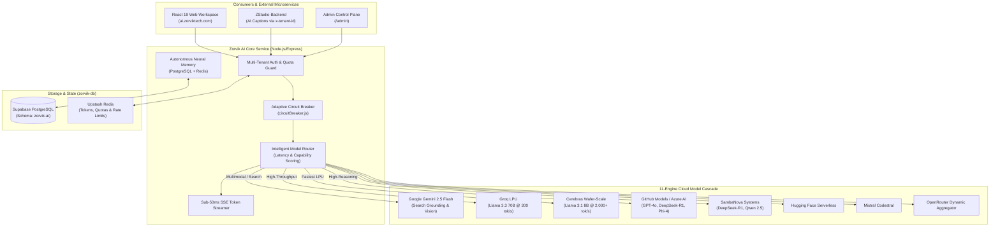

# Zorvik AI — Frontier Multi-Model Intelligence Platform & Monetization Gateway

> **Production AI Workspace, 11-Engine Cloud Cascade, Sub-50ms Upstream SSE Streaming, Voice Mode & Code Sandbox**  
> Powers high-speed generative AI, automated copywriting, visual code execution, and multi-tenant billing across the Zorvik Tech ecosystem.

[](VERSION.md)
[](https://ai.zorviktech.com)
[](https://react.dev/)
[](https://expressjs.com/)
[](https://groq.com/)
[](https://deepmind.google/technologies/gemini/)
[](https://upstash.com/)
[](LICENSE)

---

## 🌐 Production Endpoints

- **Live AI Workspace**: [https://ai.zorviktech.com](https://ai.zorviktech.com)
- **Administrative Control Plane**: `https://ai.zorviktech.com/admin`
- **Streaming Gateway API**: `POST https://ai.zorviktech.com/api/v1/chat/stream`
- **Health & Cascade Probe**: `GET https://ai.zorviktech.com/api/v1/health`

---

## 🌟 Executive Overview

**Zorvik AI** is an enterprise-grade artificial intelligence platform and multi-tenant microservice. It provides a lightning-fast React 19 web workspace paired with an 11-engine cloud cascade that intelligently routes prompts to the fastest and most cost-effective frontier models—including **Google Gemini 2.5 Flash**, **Cerebras LPU (2,000+ tok/s)**, **Groq Cloud**, **GitHub Models (Azure AI)**, **SambaNova Systems**, and **Hugging Face**.

Designed for both standalone consumer productivity and headless microservice integration (e.g., automated social media captions for `ZStudio-Backend`), Zorvik AI features live web search grounding, interactive code sandboxing, voice conversation mode, persistent neural memory, and an administrative monetization gate.

---

## 🏛️ System Architecture & 11-Engine Cascade



---

## 🚀 Key Platform Capabilities

### 1. ⚡ Native Upstream SSE Streaming Pipeline
- Sub-50ms Time-to-First-Token (TTFT) streaming direct upstream server-sent events to the browser.
- Automatic reconnection and chunk buffering ensuring zero missed words during mobile network jitter.

### 2. 🌐 Google Search Grounding & Web Research
- Real-time search queries injected into prompts via official Gemini Search Grounding.
- UI renders clickable source pills, domain badges, and structured reference citations.

### 3. 🎙️ Hands-Free Voice Conversation Mode
- **Speech-to-Text (STT)**: Real-time browser dictation with interactive canvas waveform visualizer.
- **Text-to-Speech (TTS)**: High-fidelity natural voice audio readout on all assistant replies.

### 4. 🎨 Live Code Artifacts & Interactive Sandbox
- Sandboxed real-time iframe execution for HTML5, SVG, Tailwind CSS, React/JSX, and Python snippets.
- One-click copy, download, and fullscreen code inspector.

### 5. 🧠 Autonomous Neural Memory
- Asynchronously identifies and persists user preferences, preferred coding languages, and personal facts in PostgreSQL.
- Adapts tone and context dynamically without requiring repetitive system prompt instructions.

### 6. 🛡️ Admin Control Plane & Monetization (`/admin`)
- Real-time KPI dashboard tracking token burn, active tenants, and gross revenue.
- Tenant key management with configurable subscription tiers (Starter $19/mo, Pro $49/mo, Enterprise $199/mo).
- Manual circuit breaker overrides to instantly bypass degraded upstream providers.

---

## 📁 Repository Directory Structure

```
Zorvik-AI/
├── frontend/                # React 19 Frontend Workspace
│   ├── src/
│   │   ├── components/      # ChatBox, Sidebar, CodeSandbox, VoiceMode, Admin
│   │   ├── hooks/           # useChatStream, useVoiceDictation, useAuth
│   │   ├── App.jsx          # Workspace layout
│   │   └── index.css        # Cyber-Obsidian styling
│   └── package.json
├── src/                     # Node.js / Express Backend
│   ├── config/              # Redis, Supabase, and provider API keys
│   ├── controllers/         # ChatController, AdminController, TenantController
│   ├── middleware/          # TenantAuth, rateLimiter, errorBoundary
│   ├── services/            # modelRouter.js, circuitBreaker.js, searchGrounding.js
│   └── routes/              # /api/v1/chat, /api/v1/admin
├── server.js                # Express application entry point (Port 3000)
├── .env.example             # Documented environment blueprint
├── eslint.config.js         # Strict ESLint configuration
├── package.json             # Scripts and dependencies
└── VERSION.md               # Version changelog
```

---

## ⚙️ Environment Configuration (`.env`)

Create `.env` using `.env.example`:

| Variable | Required | Description | Example / Target |
| :--- | :--- | :--- | :--- |
| `PORT` | Yes | Local server port | `3000` |
| `NODE_ENV` | Yes | Environment mode | `production` / `development` |
| `SUPABASE_URL` | Yes | Supabase PostgreSQL project URL | `https://your-project.supabase.co` |
| `SUPABASE_SERVICE_ROLE_KEY` | Yes | Elevated Supabase service key | `eyJhbGci...` |
| `UPSTASH_REDIS_REST_URL` | Yes | Upstash Redis connection endpoint | `https://your-redis.upstash.io` |
| `UPSTASH_REDIS_REST_TOKEN` | Yes | Upstash Redis authorization token | `AX...` |
| `GEMINI_API_KEY` | Yes | Google Gemini 2.5 Flash API Key | `AIzaSy...` |
| `GROQ_API_KEY` | Optional | Groq Cloud LPU API Key | `gsk_...` |
| `CEREBRAS_API_KEY` | Optional | Cerebras Wafer-Scale LPU Key | `csk-...` |
| `GITHUB_TOKEN` | Optional | GitHub Models (Azure AI) Personal Token | `ghp_...` |
| `SAMBANOVA_API_KEY` | Optional | SambaNova Systems API Key | `...` |
| `MISTRAL_API_KEY` | Optional | Mistral Codestral API Key | `...` |
| `OPENROUTER_API_KEY` | Optional | OpenRouter Aggregator Key | `sk-or-...` |
| `JWT_SECRET` | Yes | Secret for signing admin sessions | `your_super_secret_jwt_key` |

---

## 🛠️ Local Development & Quality Runbook

### 1. Install Backend and Frontend Dependencies
```bash
npm install
npm --prefix frontend install
```

### 2. Launch Local Development Server
```bash
npm run dev
```
Accessible at `http://localhost:3000` (and `http://localhost:3000/admin`).

### 3. Run Strict Linting (Zero-Warning Policy)
```bash
npm run lint
```

### 4. Automated Test Suite
```bash
npm test
```

### 5. Production Build of Frontend
```bash
npm run build
npm start
```

---

## 👨‍💻 Founder & Architectural Leadership

**Zorvik AI** is designed, architected, and maintained by:

- **Founder & Lead Architect**: **Vikash Kumar Singh**
- **Email**: [vikash@zorviktech.com](mailto:vikash@zorviktech.com)
- **Phone / WhatsApp**: [+91 8409792083](tel:+918409792083)
- **LinkedIn**: [linkedin.com/in/itsmevikashkumarsingh](https://www.linkedin.com/in/itsmevikashkumarsingh/)
- **GitHub**: [@ItsMeVikashKumarSingh](https://github.com/ItsMeVikashKumarSingh)
- **Website**: [zorviktech.com](https://zorviktech.com)

---

## 📄 License & Intellectual Property

**Copyright © 2026 Zorvik Tech. All Rights Reserved.**

This software and its associated source code, design systems, algorithms, and documentation are the proprietary intellectual property of **Zorvik Tech**. Unauthorized copying, reproduction, distribution, reverse engineering, or commercial use is strictly prohibited without prior written consent.
